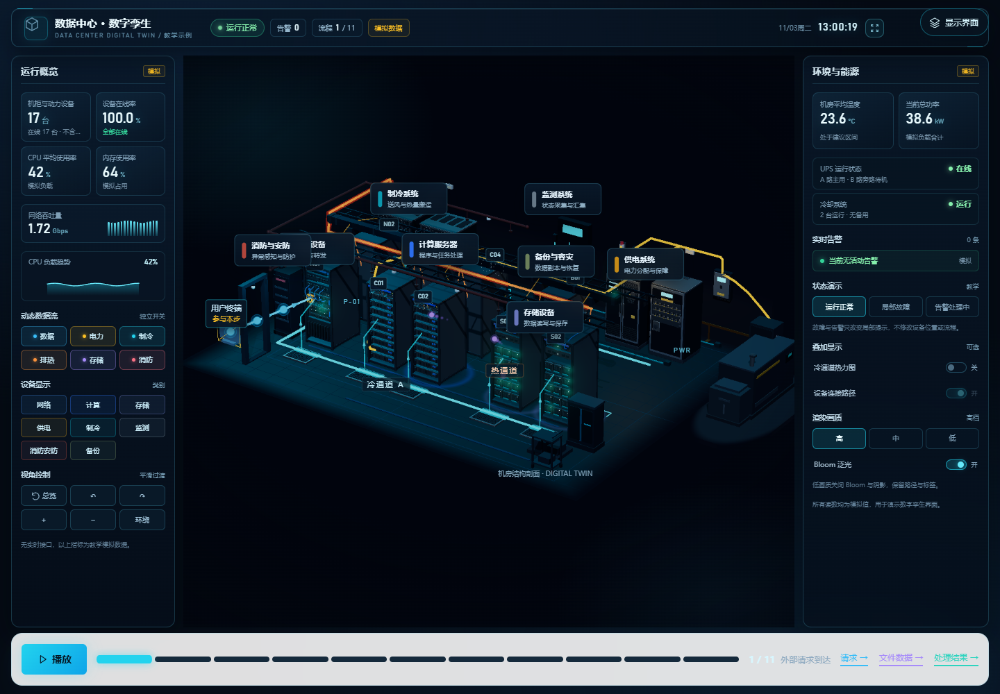
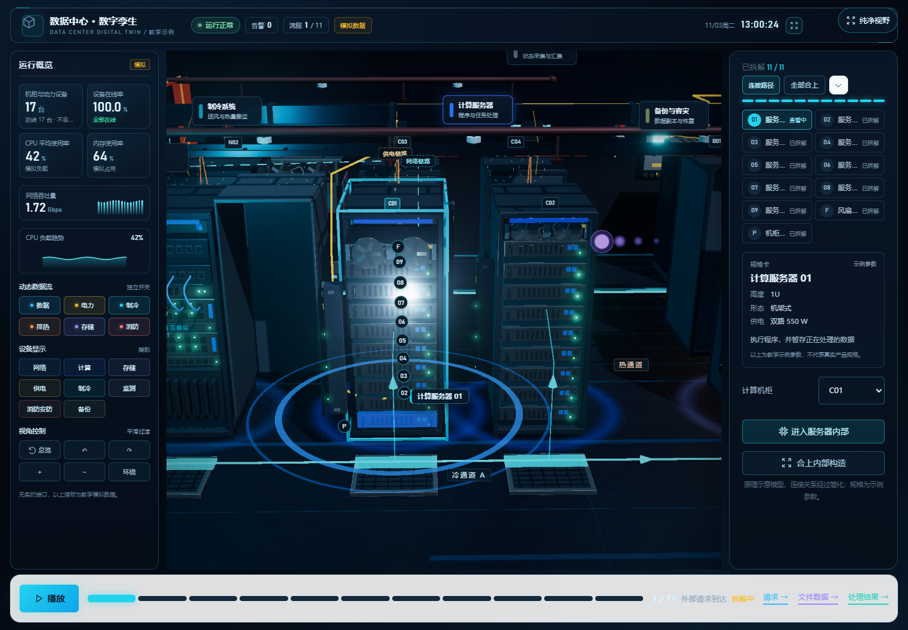
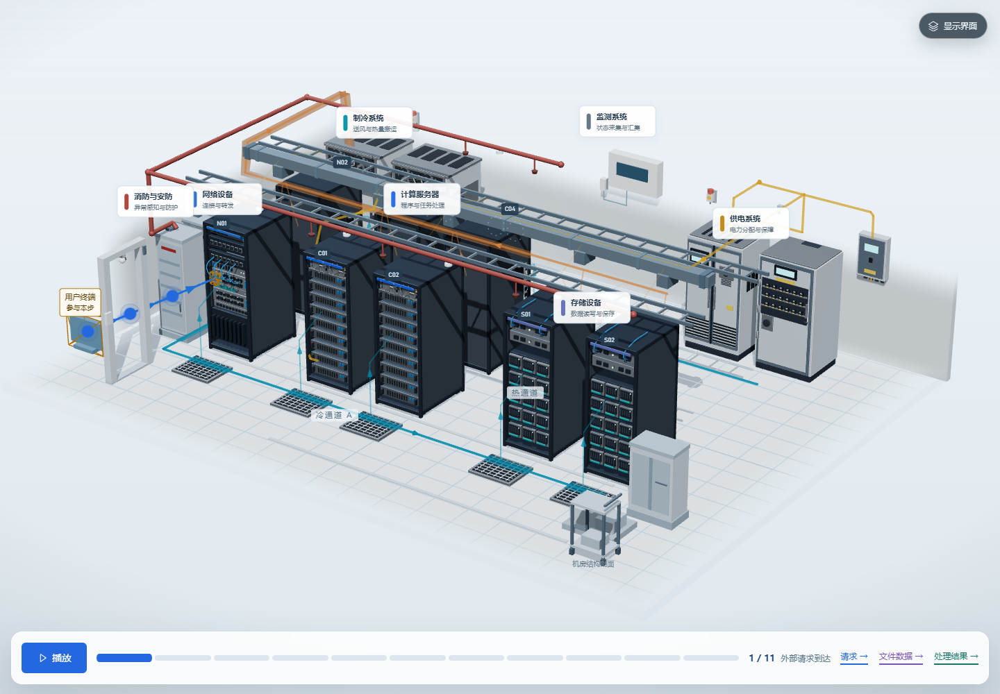

# 数据中心 · 系统工作原理

[](LICENSE)
[](https://react.dev)
[](https://threejs.org)

**Interactive 3D data-center explainer** — 用可旋转的三维机房，解释工程里各个部分的职责、输入输出与协作过程。九台原创 Blender 机柜、八个可点选的系统、一条 11 阶段的请求流程，以及供电／制冷的持续支撑演示。



| 逐件拆解 | 消防与安防 |
| --- | --- |
|  |  |

## 启动

需要 Node 20+。克隆后安装依赖并启动开发服务：

```bash
git clone https://github.com/bugan9527-tech/data-center-3d-explainer.git
cd data-center-3d-explainer
npm ci
npm run dev
```

浏览器打开终端打印的本机地址。生产构建与本地预览：

```bash
npm run build
npm run preview
```

Windows 用户也可以双击 `start-dev.cmd`。仓库内的 `.npmrc` 只设置本机 npm 缓存目录，迁移到别的机器时可以直接删掉。

## 文档

- [文档索引](docs/README.md)：现行文档、归档边界与文档约定。
- [关键制作步骤](docs/BUILD_STEPS.md)：九个步骤、十个坑与复刻检查表。
- [通用制作流程](docs/PIPELINE.md)：3D 科技可视化项目的九阶段方法，可套用到其他题材。
- [模型与素材规范](docs/ASSET_GUIDE.md)：GLB 节点契约、Blender 脚本与资产统计。
- [工程定位与范围](docs/PROJECT_PLAN.md)：讲什么、不做什么。

## 已实现

- 9 台 Blender 原创机柜（2 网络、4 计算、2 存储、1 备份）、2 台制冷设备、UPS、配电柜、上游进线箱、机柜 PDU、送风地板、母线、风扇模块和传感采集盒组成的三维示例机房；各类设备使用有结构差异的资产。
- 室外电力平台（运行时代码拼装，不占 GLB）：地板右缘 `x > 5.95` 之外的小平台，放柴油发电机组（含散热格栅、排气管、琥珀警示条）、ATS 自动转换开关柜与日油箱，用一条静态电缆接到右侧进线箱。
- 第七个系统“消防与安防”由运行时代码拼装、不占 GLB 资产：左前空地的两台灭火剂钢瓶柜、左墙报警控制器、后墙两个声光报警器、顶部沿冷通道敷设的消防主管与支管、8 个喷嘴、6 个烟感探测器、入口的两柱一楣门框与读卡终端、两个摄像头。全部件可点选并打开说明面板；面板只讲角色、输入输出与配合关系，不出现读数或告警状态。
- 网络柜从 8 件扩到 12 件：新增边界路由器（机柜顶部）、防火墙（配线场下方）、存储交换单元（两台交换单元之间）与管理交换单元（理线区上方），塞进原布局留下的空档，因此没有移动任何既有部件，11 步请求流程的设备锚点保持不变。三类网络在部件职责与系统说明里分开表述，不做按网切换高亮。
- 双路市电：后墙并排两个进线箱，A 路经 ATS 进 UPS 主输入，B 路直接进旁路输入，HUD 的“双路输入”与场景一致。
- 建筑设施小件（运行时代码拼装）：地面两条漏水检测绳（CRAC 前方、后墙侧）、后墙右段的接地母排与两条引下线、后墙顶部的两个应急照明灯。都落在实体墙段或地板上——左墙从 `y 1.15` 起淡出，挂不住东西。
- 第八个系统“备份与容灾”与一台独立机柜：后排右段的 B01 装两台备份服务器、一台 16 槽磁带库与两台备份存储架，共 5 个可拆解部件。它与前排主存储柜分开摆放，说明面板写明“备份要与主存储分开存放，本地备份也不等于异地容灾”；不做备份窗口、去重、异地复制的模拟。
- 后排机柜背靠背布置，形成中间的设备热通道和两侧冷通道；送风地板按机柜列排布，进风与排风方向与箭头一致。
- 深色数字孪生 HUD：三栏全屏布局——左侧运行概览（模拟指标、动态数据流开关、设备类别显示、视角控制），中间三维机房，右侧环境与告警（模拟读数、实时告警、状态演示、叠加显示、渲染画质）；底部一条播放条。页面没有模式标签与章节条，系统过滤与图层开关由 HUD 承担。所有读数标注为模拟，每块面板标题带“模拟”角标。
- 运行总览 HUD：顶部信息栏给出数据中心名称、运行状态、关键告警数量与当前时间，右侧附浏览器全屏按钮（Fullscreen API，全屏后 Esc 或再点一次退出，图标随 fullscreenchange 同步）；左栏设备总数／在线率／CPU／内存／网络吞吐量与模拟趋势图；右栏机房平均温度、总功率、UPS 与冷却状态、告警列表。没有真实接口的读数全部标注“模拟数据”，并在暂停时冻结趋势。
- HUD 交互：六个流向独立开关（数据／电力／制冷／排热／存储／消防）、八个设备类别显示开关、正常／故障／告警演示切换、冷通道热力图、设备连接路径开关、画质档位与 Bloom 单独开关。
- 设备交互：悬停出现编号、名称与运行状态卡片，并加青蓝描边；单击进入拆解与说明；双击进入机柜近景；总览按钮一键复位；自动环绕持续平滑转动；选中机柜用青色虚线标出网络与供电路径；C02 在故障／告警演示中只亮局部红色呼吸灯。
- 数字孪生材质与光照：深蓝黑渐变背景、深灰蓝工业地板与青蓝网格、运行时生成的 PMREM 环境贴图、PBR 金属／玻璃、机柜底部接触阴影与青色环境反射、ACES 色调映射、适度 Bloom、抗锯齿与少量点光源。
- 画质档位：高／中／低；低档关闭 Bloom、阴影与热力图，保留路径、标签与交互；Bloom 也可在 HUD 中单独关闭。
- 协作可视化：一条循环同时跑三件事——数据请求（蓝，用户终端 → 网络 → 计算 → 存储 → 返回）、电力（琥珀，进线箱 → UPS → 配电柜 → 母线 → 机柜 PDU → 设备电源）、冷空气（青，制冷设备 → 架空地板 → 送风口 → 设备；暖色回风返回）。点“播放”三条一起流动，点“停止”同时冻住。
- 播放条：播放／停止、11 段可点进度、当前步骤名与序号、三条流向的图例；拆解设备时提示“拆解中 · 演示继续”，播放不会被拆解打断。状态与进度走既有 `useWorkflow` 时钟，跨步、暂停、后台暂停的行为不变。
- 点击设备看细节：场景里有八个可点的系统标注，也可以直接点机柜本体。网络／计算／存储／备份四类会打开拆解视图（外壳滑开变半透明、部件沿 +z 拉开、编号点贴在本体上），右侧面板给出部件清单、规格卡（示例参数）与机柜切换；计算柜还提供“进入服务器内部”。
- 拆解面板：已拆解 n / n、全部合上、部件列表（点选聚焦并飞到该件机位）、规格卡、收起说明；聚焦标注走屏幕空间投影并夹在画布内，避开顶栏、面板与边缘。
- 供电与制冷也能拆：点供电系统打开 UPS（前门、控制与旁路面板、电池模块、柜体四件），面板里可切到配电柜（断路器排、总开关、计量表、柜门、柜体五件）；点制冷系统打开制冷设备（回风风扇、盘管与滤网、控制与检修门、柜体四件）。设备件沿局部坐标拉开并带标注，关闭时回到原位。
- 监测系统没有内部件，点开是“负责什么／接收什么／输出什么／与谁配合”的说明面板。
- 纯净视野（桌面默认）：隐藏品牌顶栏与说明面板，保留数字孪生 HUD 顶栏／左右监控列、三维场景、底部播放条与右上角“显示界面”胶囊；点“显示界面”唤出顶栏，Esc 亦可。HUD 属于监控画面，因此在纯净视野中保留。
- 全屏布局（≥901px）：三栏网格占满窗口，左右 HUD 为真实网格列，三维画布在中间列，说明面板占用右栏并替换环境告警列；播放条固定在底部，页面本身不滚动。窄屏（≤900px）单列堆叠，左右监控列隐藏、顶部 HUD 保留，场景在上、播放条在下，无横向溢出。
- 透视相机与运镜：总览用长焦近正交（fov 14），章节与特写用 fov 28–45 产生近大远小；镜头切换沿轻微弧线过渡，可被拖动、滚轮与新的定位请求随时中断；减少动态效果时直接定位。
- 科技感细节：设备拆解时地面出现双层扫描环（播放时才缓慢转动，暂停与减少动态效果下静止）；机柜顶部色条、青蓝地面分区线、区域编号与静态暗角把视线收到机柜上。
- 背景与光照：深蓝黑渐变背景 + 场景雾，深灰蓝工业地板配低亮度青蓝网格，地板外沿径向淡出；运行时生成的 PMREM 环境贴图为金属提供冷色反射，接触阴影与机柜底部青色环境反射把设备“压”在地面上；定向光、冷色轮廓光与局部点光保持设备可读。
- “读取并处理一份云端文件”11 阶段：外部请求 → 网络接收／转发／出口 → CPU 执行 → 存储请求／定位／读取／回传 → CPU 整理 → 网络返回 → 用户收到。请求蓝、文件数据紫、处理结果绿；当前步骤涉及的设备以金色描边标记。
- 网络 A/B/C 端口组、交换转发单元、存储控制单元和文件模块可独立高亮；服务器内部支持逐件查看（部件列表 + 顺时针 / 逆时针 / 展开视图）。
- 机房请求与服务器内部两级演示共用播放时钟与图例，支持播放、暂停、继续、手动选步、后台暂停和结束不循环；供电与制冷作为持续支撑随播放一起流动。拆解机柜不暂停、不停止演示，点“停止”也不会关闭拆解。
- 供电用琥珀色路径与方向箭头表示“ATS → UPS → 配电柜 → 母线 → 机柜 PDU → 设备电源”，起点在室外平台的 ATS 上；发电机到 ATS 的备用电缆是静态几何，因为只有市电中断时它才带电。第二路市电从后墙另一个进线箱直接接到 UPS 旁路输入，比主路更细更淡，两路互不依赖；制冷用青色表示冷空气、暖色表示吸热后的回风，图例常驻讲解面板。移动标记只表示逻辑方向，不表示电流速度或流场。
- 制冷送风主干抬到地板面上方 0.16，送风口改为从格栅中心向上喷射的短弧；冷空气与回风各有真几何半透明带（宽约 0.16 世界单位），设备内以 7 个青→暖插值点表示吸热；CRAC 与机柜风扇外圈增加极淡旋涡短线，随播放转动，暂停与减少动态效果时停转。
- 持续支撑基底机位：进入持续支撑或切换供电／制冷章节时移到对应基底机位（供电偏右，框住 UPS → 配电柜 → 母线 → C01；制冷偏左、俯角抬高，框住两台 CRAC、地板与前排进风侧）；普通设备选择与选步不移动镜头。持续支撑播放（普通界面）在开始和切步时自动切到本步特写，暂停保持当前视角；展品模式保持不自动切机位。制冷第 4／5 步的按钮改为“放大看机柜内部气流”并带跳动提示，只有点击才进入特写，不自动切机位。
- 持续支撑播放时底部卡片收成 64px 迷你条（当前步骤名、步骤进度与暂停按钮），章节与图层胶囊移到迷你条上方；暂停、结束或手动选步后恢复完整卡片。迷你条只在持续支撑中使用，协作流程卡片不变。
- 三种展示方式：单独观察供电、单独观察制冷、“在协作流程中同时查看”。同时显示时请求路径为主，支撑路径变细并降低透明度，并显示“持续支撑（不属于请求步骤）”的摘要与单独观察入口。
- 用户选中（蓝框与勾选）、当前讲解强调（节点描边与“参与本步”）、持续支撑（文字列表标记）三种状态分开表达。
- 当前步骤的每条路径带 3 个相位错开的流头（运行时生成的硬边核心 + 淡环贴图，各带 3 段渐隐短尾），另有三枚沿曲线走在流头前方的箭头（相位偏移按曲线长度换算）与 7 段流动虚线；供电／制冷每步最多 2 条路径（同屏最多 24 个 sprite，≤40）。暂停时全部冻结，减少动态效果时不生成流光与巡游，箭头固定在 1/4、1/2、3/4 并保留首尾高亮。
- 静止场景按需渲染；减少动态效果时保留静态箭头和文字，停止移动标记与风扇；窄屏隐藏空间浮动标注，文字设备列表可完整操作。
- 计算机柜 C01–C04 可通过模型或文字选择，打开其中的 01 号服务器；返回机房保留系统、机柜、模式、路径开关、展开状态及旋转缩放视角，并恢复入口焦点。
- 服务器内部有独立可选的网卡、CPU、内存、主板、电源模块和风扇，提供完整视图（隐藏顶盖）、展开视图、视角复位和可用键盘操作的旋转／缩放按钮。
- 模型与文字列表双向联动；说明包含部件职责、配合关系与当前阶段工作。主板负责连接和电力分配，CPU 执行计算。
- “读取并处理一份文件”五阶段演示：接收请求 → 执行程序 → 从外部存储读入内存 → CPU 处理内存数据 → 返回结果。箭头与移动标记表达数据方向，电源、风扇持续支撑。
- 播放、暂停、继续、重新开始、手动选步；暂停保留步骤与移动进度，手动选步会暂停并回到该步起点，重新开始回到第一步并暂停，播放结束不自动循环。切到后台时自动暂停。
- 业务示例固定使用 N01、C01 的 01 号服务器与 S01；其他设备保留为空间背景且可单独观察。进入内部时暂停机房，内部从对应原理阶段独立查看；返回保留机房阶段与分数进度，点击继续后恢复。
- 内部界面、三维模块和 GLB 在进入时加载；先推近机柜，内部绘制就绪后淡入切换。准备期间机房可见并可取消；返回等待机房绘制后恢复原视角。退出卸载内部画布，保留 GLB 缓存。减少动态效果开启时保留静态箭头，停止移动标记。

这是教学用的简化示例架构，模型与路径用于解释分工，不对应具体真实机房的精确设计。

## 工程结构

| 文件或目录 | 用途 |
| --- | --- |
| `src/App.jsx` | 模式、系统选择、工作流程、HUD 状态与说明面板 |
| `src/data/systems.js` | 八个系统的职责讲解 |
| `src/data/twinData.js` | 深色科技配色、画质档位、模拟指标与流向图层定义 |
| `src/components/RoomHud.jsx` | 顶部信息栏、左侧运行概览、右侧环境告警与交互开关 |
| `src/scene/TechEnvironment.jsx`、`src/scene/techMaterials.js` | 运行时 PMREM 环境贴图、材质校色、接触阴影与光环贴图 |
| `src/scene/Bloom.jsx` | 按需渲染的 Bloom 合成器，可整体关闭 |
| `src/scene/TwinEffects.jsx` | 存储脉冲、设备连接路径、冷通道热力图 |
| `src/data/supportSystems.js` | 供电与制冷的节点、步骤、路径、文案与默认图层 |
| `src/scene/SupportVisualization.jsx` | 支撑路径、箭头、移动标记与节点框 |
| `src/scene/Infrastructure.jsx` | UPS、配电柜、进线箱、制冷设备、送风地板、机柜 PDU、风扇模块与母线 |
| `src/scene/SafetyInfrastructure.jsx` | 消防与安防设备：钢瓶柜、报警控制器、声光、烟感、喷嘴、消防管路、门禁门框、摄像头（纯 primitives 拼装，不进 Blender） |
| `src/scene/primitives.jsx` | 场景共用的基础几何 |
| `src/components/SupportPanel.jsx` | 供电与制冷的分步讲解、播放控制与节点列表 |
| `src/data/requestFlow.js` | 11 阶段、设备拓扑、输入输出与内部阶段映射 |
| `src/scene/RequestVisualization.jsx` | 当前逻辑路径、方向箭头、移动标记和独立节点框 |
| `src/components/FlowLegend.jsx` | 两级共用的路径颜色与选择图例 |
| `src/scene/DataCenterViewport.jsx` | 三维机房、模型复用、灯光、材质、路径、热力图与 Bloom 装配 |
| `src/data/roomLayout.js` | 九个机柜位置与资产映射 |
| `src/data/roomCameras.js` | 七个机位组（章节、支撑特写、功能机位、拆解、部件、基础设施、支撑基底）与取景系数 |
| `src/data/rackParts.js`、`src/data/infraParts.js` | 机柜与基础设施的可拆解部件清单、规格示例与聚焦机位映射 |
| `src/scene/RoomCameraRig.jsx` | 透视取景、可中断弧线过渡、自动环绕与用户视角保存 |
| `src/scene/floorFade.js` | 运行时生成的地板／墙面世界坐标淡出贴图 |
| `src/scene/FloorProps.jsx` | 基座与右前空地的道具模型 |
| `src/scene/PowerExterior.jsx` | 室外电力平台：柴油发电机组、ATS、日油箱与到进线箱的静态电缆 |
| `src/scene/FacilityFittings.jsx` | 建筑设施小件：漏水检测绳、接地母排与引下线、应急照明 |
| `src/scene/glowTexture.js`、`src/scene/FlowGlow.jsx` | 运行时流光贴图、发光头与尾迹 |
| `src/scene/SceneReady.jsx` | 目标场景绘制就绪通知 |
| `src/hooks/useRoomTransition.js` | 进入、取消、返回和状态恢复 |
| `src/components/ServerExperience.jsx` | 服务器内部界面、部件选择与展示方式 |
| `src/data/server.js` | 六部件讲解、五阶段流程、标注和展开偏移 |
| `src/hooks/useWorkflow.js` | 两级共用的时间进度、暂停继续、阶段推进与后台暂停 |
| `src/hooks/useServerWorkflow.js` | 内部五阶段的配置适配 |
| `src/scene/ServerViewport.jsx` | 懒加载内部 GLB、可选装配、逻辑路径、标记、镜头 |
| `src/components/SceneBoundary.jsx` | 三维异常时的文字操作降级提示 |
| `src/components/Icon.jsx` | 项目使用的 SVG 图标 |
| `src/styles/global.css` | 界面布局与响应式样式 |
| `public/models/server-rack.glb` | 网页使用的计算柜模型 |
| `public/models/infrastructure.glb` | 供电与制冷设备、送风地板与风扇模块 |
| `blender/source/generate_infrastructure.py` | 可复现的基础设施建模脚本 |
| `blender/source/infrastructure.blend` | 对应可编辑源文件 |
| `public/models/network-rack.glb`、`storage-rack.glb`、`backup-rack.glb` | 专用网络柜、存储柜与备份柜 |
| `blender/source/generate_equipment.py` | 网络柜、存储柜与备份柜可复现建模脚本 |
| `blender/source/network-rack.blend`、`storage-rack.blend`、`backup-rack.blend` | 对应可编辑源文件 |
| `blender/source/generate_rack.py` | 可复现的原创机柜建模脚本 |
| `blender/source/server-rack.blend` | Blender 可编辑源文件 |
| `blender/source/generate_server.py` | 可复现的原创服务器内部建模脚本 |
| `blender/source/server-internal.blend` | 服务器内部可编辑 Blender 源文件 |
| `public/models/server-internal.glb` | 网页使用的服务器内部模型 |
| `scripts/verify-*.browser.cjs` | Playwright CLI 浏览器回归脚本；`verify-twin` 覆盖数字孪生 HUD 与交互 |
| `scripts/verify-browser.ps1` | 运行 collab／teardown／server／responsive／fallback／resources／safety／backup 八份回归，保存 JSON 与截图 |
| `scripts/inspect-assets.py` | 无额外依赖的 GLB 资产统计 |
| `scripts/archive/` | 历史脚本：旧模式时代的回归（`legacy-verify/`）与一次性截图脚本（`captures/`），不参与默认验证 |
| `outputs/` | 当前回归产物：`verification-*.json`、`*-check.log`、数字孪生与消防等当前截图 |
| `outputs/archive/` | 历史阶段截图，可整体删除或移出仓库 |
| `docs/README.md` | 文档索引：现行文档、归档边界与文档约定 |
| `docs/BUILD_STEPS.md` | 关键制作步骤：数据→灰模→相机→时间源→路径→拆解→界面→断言→收口 |
| `docs/PIPELINE.md` | 3D 科技可视化项目的通用制作流程与题材迁移方法 |
| `docs/concepts/` | 目标效果概念图，不作为应用界面的背景替代品 |
| `docs/archive/` | 过程文档归档（方案、验证记录、提示词原文、任务书） |
| `docs/` | 项目范围、模型规范与数字孪生改造记录 |

模型由 Blender 4.5 脚本生成，仓库里已带导出的 GLB，只改前端时不需要装 Blender。要重新生成，把命令里的 `blender` 换成本机可执行文件路径：

```bash
blender --background --factory-startup --python-exit-code 1 --python blender/source/generate_rack.py
blender --background --factory-startup --python-exit-code 1 --python blender/source/generate_server.py
blender --background --factory-startup --python-exit-code 1 --python blender/source/generate_equipment.py
blender --background --factory-startup --python-exit-code 1 --python blender/source/generate_infrastructure.py
```

脚本无外部素材依赖，全部用 Blender 自带基础网格原创拼装。

## 使用与验证

底部播放条只有播放／停止与 11 段可点进度；拆解设备时提示“拆解中 · 演示继续”，播放不会被拆解打断。点击设备模型查看说明不改变业务进度。

点击顶部与左侧 HUD 中的流向开关、类别开关、状态演示、热力图、画质与 Bloom 控件实时改变场景；数字孪生读数会随播放缓慢变化，暂停时冻结。用左侧“视角控制”的“总览／左转／右转／放大／缩小／环绕”操作镜头；自动环绕可随时关闭，拖动场景也会暂时接管镜头。设备悬停出现编号、名称与状态卡片，双击进入近景；单击仍打开说明与拆解。

点底部“播放”，数据、电力、冷空气三条路径同时流动；再点一次“停止”即冻住当前位置，进度条可点任意一段跳到该阶段。点场景里的系统标注或直接点机柜：网络／计算／存储／备份会打开拆解视图，右栏列出部件、规格卡与机柜选择，计算柜还能“进入服务器内部”；供电／制冷／监测打开的是职责说明。拆解时可切换“连接路径”，场景用青色虚线与琥珀虚线标出该机柜的网络与供电路径；故障／告警演示只让 C02 出现局部红色呼吸灯，告警模式额外高亮消防管线与喷嘴。

选择“计算服务器”，通过计算机柜选择框选择 C01–C04，点击“打开服务器内部”。从左侧列表或三维部件选中 CPU、内存、网卡；切换展开视图后操作下方流程。Tab 遍历控件，Enter／空格操作按钮，方向键操作原有模式标签和机柜选择框。小屏幕的部件说明在流程下方。

本轮构建通过，生产页面 Chrome 浏览器 8 套回归逐套独立运行共 **179 项**检查通过（collab 34、teardown 67、server 16、responsive 25、fallback 9、resources 4、safety 15、backup 9），另加数字孪生专项 `verify-twin` **34 项**，合计 **213 项**，正常交互无控制台错误。覆盖：没有模式标签与章节条、播放条播放与停止、进度跨步、空格与 Esc、八个系统标注可点、三类机柜与 UPS／配电柜／制冷设备的拆解清单与规格卡、部件聚焦机位与标签落在画布内、进入服务器内部与返回、无 WebGL 时的文字设备列表与降级阅读、375 宽无横向溢出、减少动态效果静止；数字孪生专项覆盖 HUD 三栏、模拟数据标识、悬停卡片、流向开关、拆解链路、双击近景、故障／告警演示、热力图、自动环绕与复位、Bloom 与低画质降级、设备类别隐藏、浏览器全屏进出与图标同步。旧的四模式（整体结构／工作分工／持续支撑）与展品模式脚本已归档到 `scripts/archive/legacy-verify/`，一次性截图脚本在 `scripts/archive/captures/`，均不默认执行。

阶段记录与过程文档已归档，见 [文档索引](docs/README.md)：视觉与镜头的实施细节在 [视觉优化方案](docs/archive/VISUAL_UPGRADE_PLAN.md)，供电制冷的首次落地在 [支撑验证](docs/archive/SUPPORT_VALIDATION.md)，11 阶段请求与服务器内部在 [请求流程验证](docs/archive/REQUEST_FLOW_VALIDATION.md)、[服务器内部验证](docs/archive/SERVER_VALIDATION.md)。想照着做一遍（换题材重新做也行）看 [关键制作步骤](docs/BUILD_STEPS.md)；本项目自己的过程记录在 [归档](docs/archive/)。

安装有 Playwright CLI 和 Chrome 时，在项目根目录先启动应用，再执行（端口以实际输出为准）：

```powershell
npm.cmd run verify:browser -- -Url http://127.0.0.1:5173/
python scripts/inspect-assets.py
```

包装脚本自动打开独立浏览器、执行八份检查、保存 JSON 和实际截图并关闭测试会话。也可手动单独运行：

```powershell
playwright-cli -s=server-check open http://127.0.0.1:5173/ --browser=chrome
playwright-cli -s=server-check run-code --filename=scripts/verify-collab.browser.cjs
playwright-cli -s=server-check run-code --filename=scripts/verify-teardown.browser.cjs
playwright-cli -s=server-check run-code --filename=scripts/verify-server.browser.cjs
playwright-cli -s=server-check run-code --filename=scripts/verify-responsive.browser.cjs
playwright-cli -s=server-check run-code --filename=scripts/verify-fallback.browser.cjs
playwright-cli -s=server-check run-code --filename=scripts/verify-resources.browser.cjs
playwright-cli -s=server-check run-code --filename=scripts/verify-safety.browser.cjs
playwright-cli -s=server-check run-code --filename=scripts/verify-backup.browser.cjs
playwright-cli -s=twin-check open http://127.0.0.1:5173/ --browser=chrome
playwright-cli -s=twin-check run-code --filename=scripts/verify-twin.browser.cjs
```

脚本使用当前页面的 origin；若 Vite 换用了其他端口，请相应调整 open 地址。核心回归脚本固定 1440×1100 以验证 CPU 实体网格点击，响应式脚本另行覆盖四种尺寸，数字孪生专项使用 1440×1000。结果会在命令行显示，并更新 `outputs/` 实际截图（`twin-hud.png`、`twin-hover.png`、`twin-teardown-links.png`、`twin-fault.png`、`twin-alarm.png`、`twin-heatmap.png`、`twin-low.png`、`twin-hide-compute.png`）。

网络／计算／存储机柜 GLB 分别约 365／456／558 KiB，按类别复用；备份柜 GLB 约 457 KiB（8 网格、6,612 三角形、5 个 `part_*` 部件），只放一台；网络柜 15 网格、6,612 三角形（12 个 `part_*` 部件，含新增的边界路由器、防火墙、存储交换单元与管理交换单元）；基础设施 GLB 约 697 KiB（49 网格、10 材质、12,292 三角形）；机柜、基础设施与内部资产均无贴图。服务器内部 GLB 为 205,252 字节、25 个网格、10 个材质、2,768 个三角形，无贴图和外部模型。采用共享几何／材质、实例克隆及按需渲染，像素比上限 1.5。没有在目标硬件上进行帧率、显存或长时间运行基准测试，不承诺 FPS。

范围限制：本轮完整实现读取，不提供写入流程。端口、连接和存储介质均为教学抽象，不模拟真实协议时序；不制作完整自动镜头导览，也未实现播放时相机微移（A4）。HUD 的在线率、CPU、内存、吞吐、温度、功率等读数均为明确标注的模拟数据，不连接任何实时接口；故障与告警演示只改变局部提示、告警文案与消防管线高亮，不模拟真实故障判定、切换或处置流程。四个计算机柜使用同一教学服务器结构；只展示各柜的 01 号服务器。完整视图隐藏顶盖以便观察，展开距离和箭头均为教学表达，不模拟真实指令、操作系统调度、电路信号、散热流体或冗余切换。供电与制冷只讲正常工作：不模拟电网故障、UPS 切换、电池充放电时序、双路电源、风量平衡、CFD、温度场或制冷量计算；静压层送风路径画在地板表面以便观察，冷通道热力图仅是示意，不是实测温度场。后半排机柜旋转 180° 是为了让进风／排风方向自洽，实际机房布置会因设计而不同。只细化 C01 的机柜 PDU 与设备电源，其余机柜只画母线分支。未扩展故障排查、维修教学或性能监控。消防与安防的告警演示只高亮既有管线与设备，不模拟火警探测判定、灭火剂喷放、门禁权限校验或真实告警状态色；场景没有吊顶，消防主管按示意高度 `y 2.96` 敷设，不做吊架。网络柜里新增的存储交换单元与管理交换单元是“设备在场”的表达：11 步请求流程仍沿 C 端口组 → 主交换单元 → 存储控制器，不改为经存储交换单元转发，也不模拟管理网的带外流量；防火墙同理，不展开逐条规则。备份柜不参与 11 步流程，也不模拟备份任务、备份窗口或恢复演练，只表达设备构成与分区关系。回归脚本需对着生产构建（`npm.cmd run preview`）运行：dev server 下 `verify-responsive` 会因 drei `Html` 在开发态双渲染时的根卸载竞态报控制台错误，生产构建 8 套回归逐套运行 179 项与数字孪生专项 34 项全部通过。现有三维依赖仍有 `THREE.Clock` 弃用警告，构建仍提示公共三维包超过 500 kB。

## 开源许可

代码与模型采用 [MIT License](LICENSE) 发布，可自由使用、修改与再分发，保留版权声明即可。

- 所有机柜、服务器内部与基础设施模型均由本仓库的 Blender 脚本原创生成，没有第三方模型、贴图或字体授权依赖。
- 运行时贴图（径向渐变、接触阴影、流光）全部由 canvas 现场生成，仓库内没有外部图片素材。
- `docs/concepts/data-center-explainer.png` 是 AI 生成的视觉方向参考图，仅说明目标效果，不是应用界面的一部分。

如果这个项目对你有用，欢迎开 issue 讨论教学表达或提 PR 补充新的系统模块。
